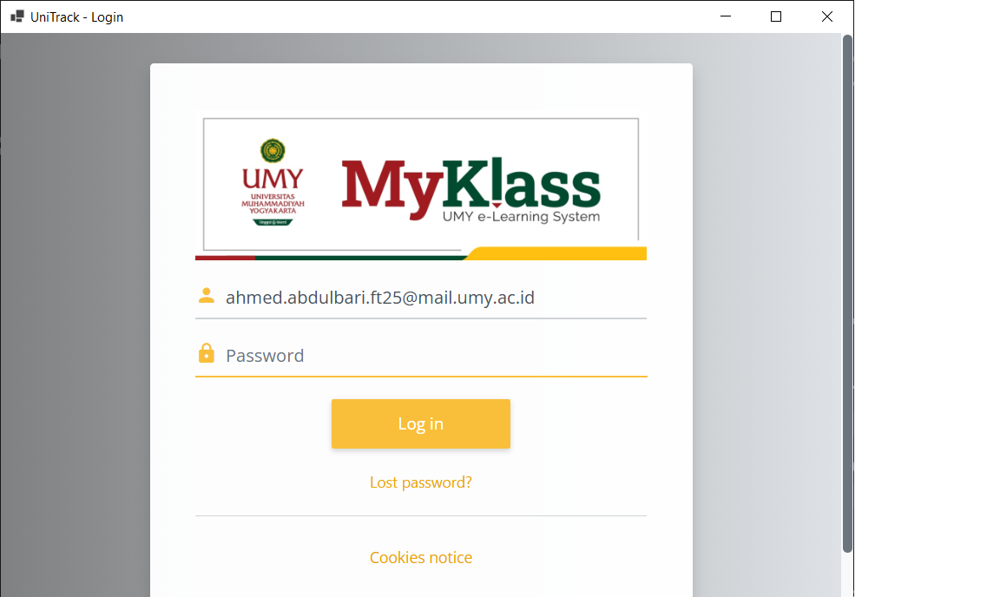
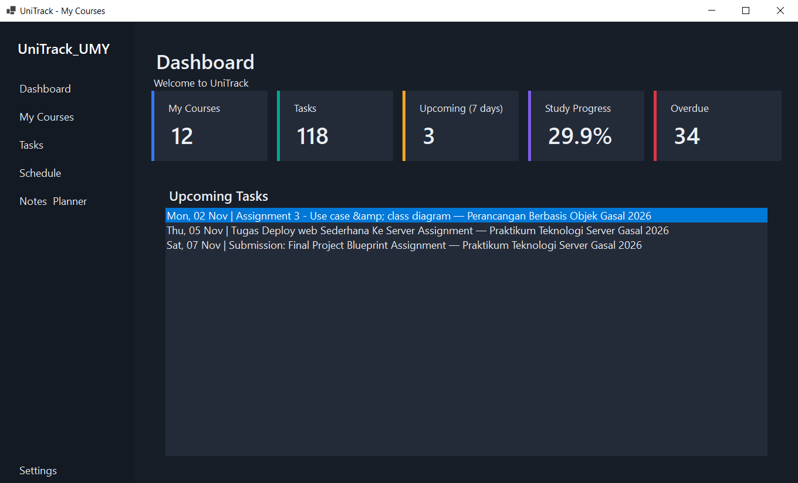
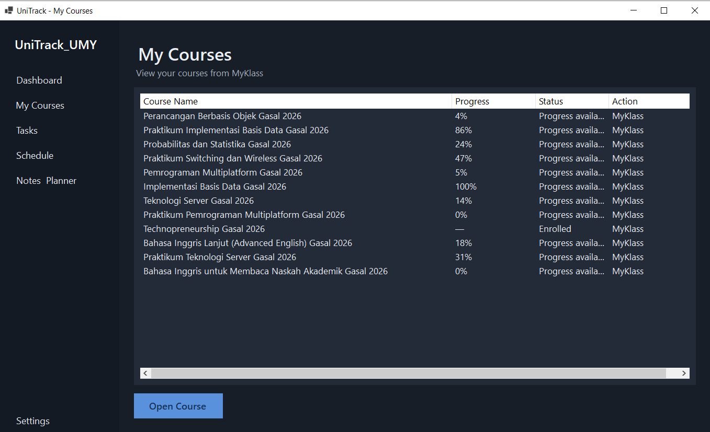
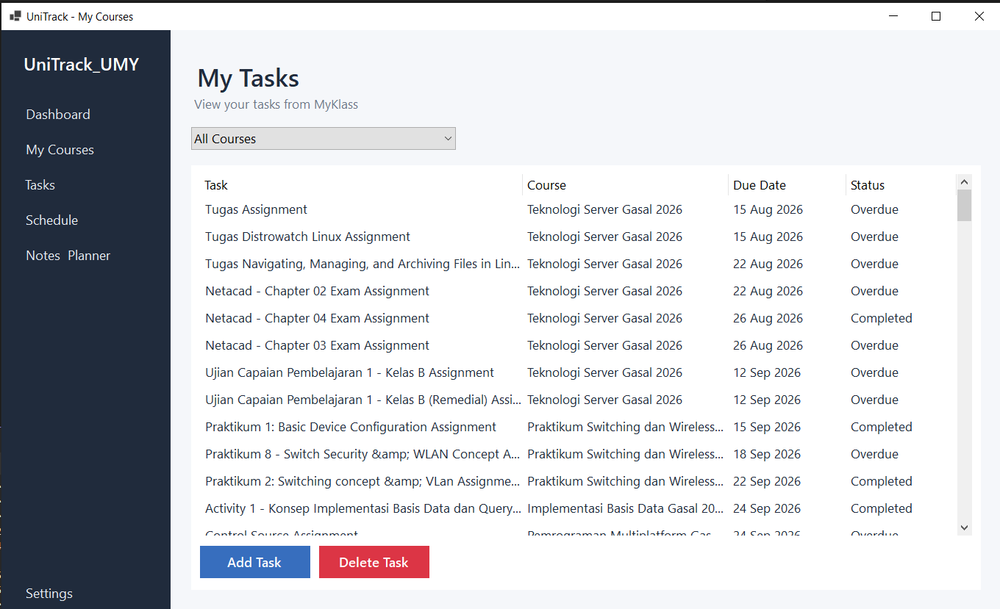
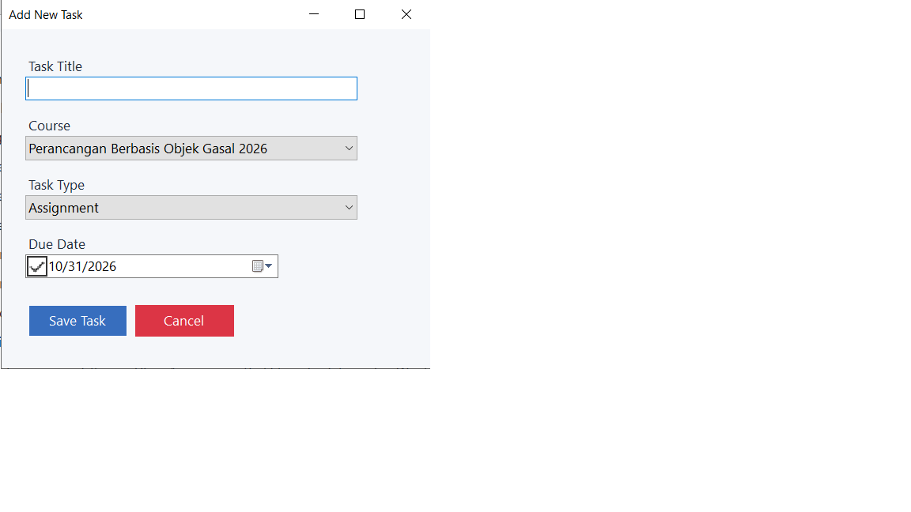
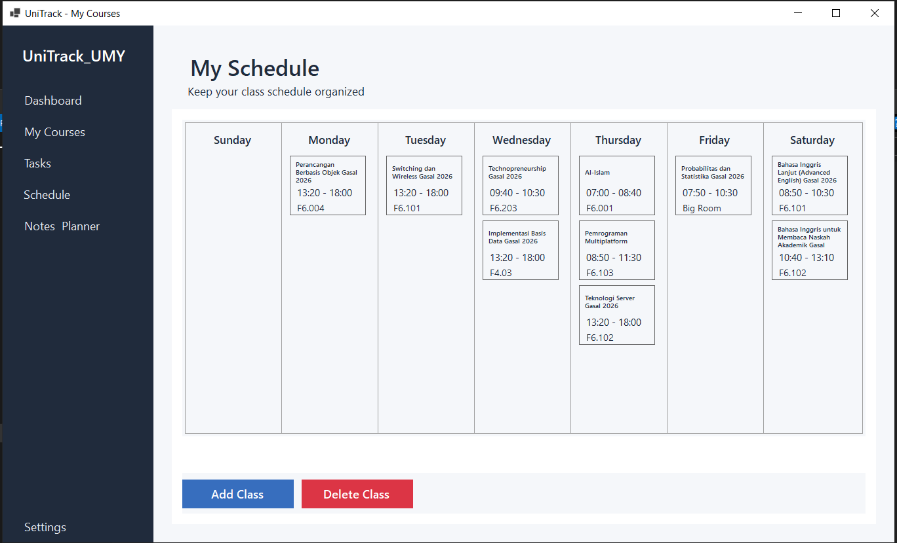
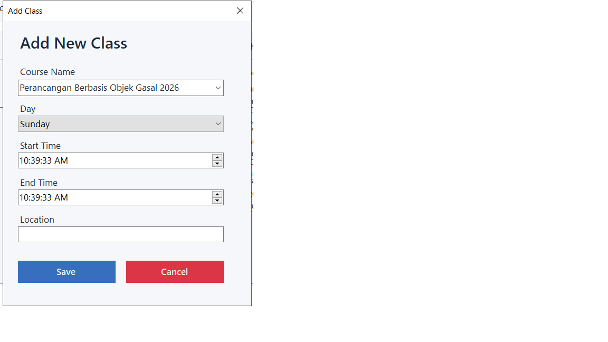
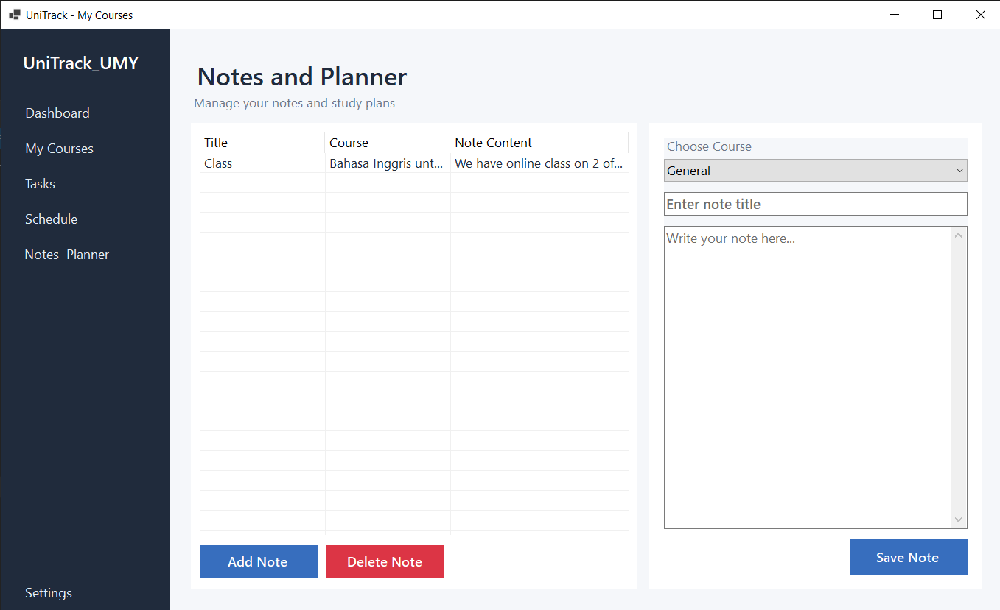
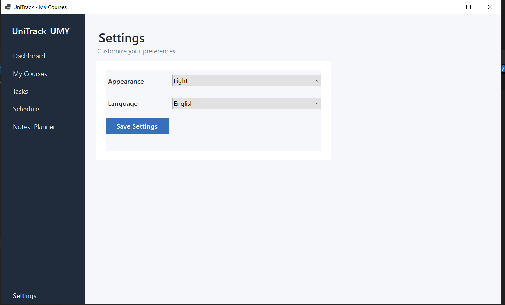

# UniTrack UMY

UniTrack UMY is a Windows desktop application designed to help Universitas Muhammadiyah Yogyakarta (UMY) students organize their academic activities in one place. It connects to the student's MyKlass session to retrieve course and supported activity information, while also providing tools for managing personal tasks, class schedules, and study notes.

> **Project status:** Under active development. Features, interface details, and MyKlass parsing support may change.

## Features

- **MyKlass sign-in:** Open MyKlass inside the application using Microsoft Edge WebView2.
- **Course overview:** Retrieve and display courses available to the signed-in MyKlass account.
- **Task tracking:** Display supported MyKlass activities, including assignments and quizzes, with course, due-date, and status information.
- **Manual tasks:** Add personal tasks, select a course and task type, and set a due date.
- **Task filtering:** Filter the task list by course.
- **Class schedule:** Add classes to a weekly Sunday–Saturday schedule. Course names can be selected from retrieved MyKlass courses or entered manually. Each class stores its day, start time, end time, and location.
- **Schedule management:** Select a class card and delete the selected class after confirmation.
- **Notes and planner:** Create and manage study notes, optionally associating them with a course.
- **Preferences:** Change the application appearance and language.
- **Local data storage:** Store application-managed information locally.

The courses and activities retrieved from MyKlass depend on the signed-in account, MyKlass availability, and the page structure supported by the parser. Manually created schedule entries and other locally managed data are separate from MyKlass data.

## User Interface

The screenshots below are stored in the repository's `UI` folder.

### Login



The login screen displays MyKlass inside the application through WebView2. Students sign in using their own MyKlass credentials.

### Dashboard



The dashboard provides a quick overview of courses, tasks, upcoming activities, study progress, and overdue tasks. It also displays a list of upcoming tasks.

### My Courses



Displays the courses retrieved from the signed-in MyKlass account, along with available course progress and status information. The user can open a selected course in MyKlass.

### Tasks



Displays tasks collected from MyKlass in a table, including the task title, course, due date, and status. The course filter helps narrow the list. Users can add or delete manual tasks.

### Add Task



A form for creating a manual task. The user enters a title, chooses a course and task type, and selects a due date.

### Weekly Schedule



Displays the weekly class schedule from Sunday to Saturday. Users can add a class and delete a selected class. A class entry includes its course name, day, start and end times, and location.

### Add Class



A form for adding a class to the weekly schedule. It includes the course name, day, start time, end time, and location. Course names can come from MyKlass or be entered manually.

### Notes and Planner



Allows students to create and manage study notes. A note can be associated with a course and contains a title and note content.

### Settings



Allows the user to customize application preferences, including the appearance theme and interface language.

## Technology Stack

- **Language:** C#
- **Platform:** .NET 10 for Windows
- **Desktop UI:** Windows Forms
- **MyKlass integration:** Microsoft Edge WebView2
- **HTML parsing:** HtmlAgilityPack
- **Testing:** xUnit
- **Data storage:** Local files (JSON)

## Requirements

To build and run the project from source:

- Windows 10 or later
- Visual Studio 2022 with the .NET desktop development workload, or the .NET 10 SDK
- Microsoft Edge WebView2 Runtime
- An active UMY MyKlass account

## Getting Started

1. Clone the repository:

   ```bash
   git clone https://github.com/Aseelcoding/UniTrack_UMY.git
   ```

2. Open `UniTrack_UMY.slnx` in Visual Studio.
3. Restore NuGet packages.
4. Build and run the `UniTrack_UMY.WinForms` project.
5. Sign in to MyKlass through the login screen.

## Build from the Command Line

Run these commands from the repository root:

```bash
dotnet restore UniTrack_UMY.slnx
dotnet build UniTrack_UMY.slnx -c Release
```

To publish a self-contained 64-bit Windows build:

```bash
dotnet publish UniTrack_UMY.WinForms/UniTrack_UMY.WinForms.csproj -c Release -r win-x64 --self-contained true
```

Distribute the complete publish output folder (or a ZIP of that folder), not only the executable.

## Project Structure

```text
UniTrack_UMY/
├── UI/                           # Application screenshots used in this README
├── UniTrack_UMY.Core/             # Models and shared application logic
├── UniTrack_UMY.Infrastructure/   # Parsing, storage, and application services
├── UniTrack_UMY.WinForms/         # Windows Forms interface
├── UniTrack_UMY.Tests/            # Automated tests
└── UniTrack_UMY.slnx
```

## Notes

- UniTrack does not provide MyKlass accounts. Each user signs in with their own account.
- MyKlass extraction depends on MyKlass being reachable and on its page structure matching the parser's supported content.
- The WebView2 Runtime may need to be installed separately on the target computer.
- Keep all files produced by publishing together when distributing the application.
- Do not share your MyKlass password, cookies, or session data.

## License

No license has been specified for this repository. Until a license is added, the repository's contents are not granted an open-source license by default.
